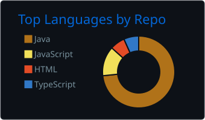
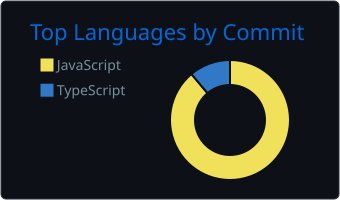

### Hi there 👋

<!--
**agnesjaque/agnesjaque** is a ✨ _special_ ✨ repository because its `README.md` (this file) appears on your GitHub profile.

Here are some ideas to get you started:

- 🔭 I’m currently working on my career transition to QA
- 🌱 I’m currently learning Java, manual and Automatizaded Tests
- 👯 I’m looking to collaborate on any project that would help me to improve my knowledge
- 🤔 I’m looking for help with beem an specialist
- 💬 Ask me about anything related
- 📫 How to reach me: https://www.linkedin.com/in/jaqueline-agnes-50a0b92a
- 😄 Pronouns: She / Her
- ⚡ Fun fact: When I was chosing my career at 16, I was about to start a Computer Science Bachelor degree and ended up starting Phisical Education and then changed to Business Administration.
-->

<a href="https://github.com/agnesjaque">

  
  

